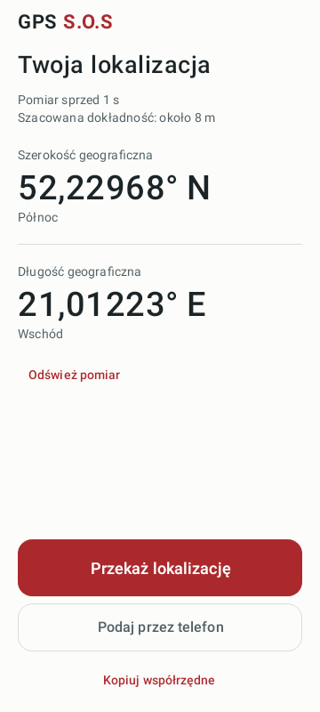

# GPS S.O.S

Prosta aplikacja na Androida do odczytania i przekazania współrzędnych, także wtedy, gdy trudno się skupić. Duże cyfry, gotowa wiadomość i osobny widok do dyktowania przez telefon. Interfejs jest po polsku; jasny lub ciemny motyw dobiera się do ustawień telefonu.



*Zrzut z testu interfejsu. Współrzędne są przykładowe.*

## Instalacja i pierwsze użycie

Wymagany jest **Android 8.0 lub nowszy**. Pobierz `GPS-SOS-1.0-debug.apk` z [wydań projektu](https://github.com/villainser/gps-sos/releases). To wersja testowa, podpisana kluczem debug. Nie została jeszcze sprawdzona z rzeczywistym odbiornikiem GPS na telefonie.

1. Otwórz pobrany APK na telefonie. Jeżeli Android o to poprosi, zezwól używanej przeglądarce lub aplikacji Pliki na instalację tej aplikacji.
2. Uruchom GPS S.O.S i wybierz **Zezwól na lokalizację**. Przyznaj dostęp podczas używania aplikacji i wybierz dokładną lokalizację, jeśli Android pokazuje taki wybór.
3. Poczekaj na współrzędne. Sprawdź czas pomiaru i szacowaną dokładność.
4. Wybierz sposób przekazania pozycji:

| Przycisk | Działanie |
| --- | --- |
| **Przekaż lokalizację** | Otwiera systemowe udostępnianie z gotową wiadomością. Wybierz odbiorcę lub aplikację i wyślij wiadomość w tej aplikacji. |
| **Podaj przez telefon** | Zatrzymuje wybrane współrzędne i pokazuje cyfry zapisane słownie. Ekran pozostaje włączony podczas dyktowania. Powrót do głównego widoku pokazuje nowszą pozycję. |
| **Kopiuj współrzędne** | Kopiuje wiadomość zawierającą współrzędne, czas, szacowaną dokładność i link do mapy. |

Aplikacja nie wysyła wiadomości samodzielnie ani nie powiadamia służb ratunkowych. Odbiorcę i wysłanie wybierasz w aplikacji do wiadomości.

## Gdy lokalizacja nie jest gotowa

Przed pierwszym pomiarem przekazanie pozycji pozostaje niedostępne. Przy braku uprawnień lub wyłączonej lokalizacji aplikacja prowadzi do odpowiednich ustawień. Jeśli oczekiwanie się przedłuża, spróbuj uzyskać odczyt w miejscu z lepszym odbiorem sygnału.

Pomiar mający co najmniej 60 sekund jest oznaczony jako **ostatnia znana lokalizacja**. Oznaczenie trafia również do wiadomości. Pozycja przybliżona i lokalizacja testowa mają osobne oznaczenia. Pięć miejsc po przecinku opisuje format współrzędnych; rzeczywistą dokładność pokazuje informacja w metrach.

GPS może działać bez internetu, ale czas uzyskania pozycji zależy od telefonu i warunków odbioru. Wysłanie wiadomości oraz otwarcie mapy zależą od wybranej aplikacji i dostępnej łączności.

## Prywatność

GPS S.O.S pobiera lokalizację podczas widoczności aplikacji. Nie zapisuje historii współrzędnych, nie wymaga konta i nie zawiera analityki ani uprawnienia do internetu. Wybranie kopiowania lub udostępniania przekazuje dane do schowka lub innej aplikacji. Wiadomość zawiera link do Google Maps; otwarcie linku przekazuje zawarte w nim współrzędne do usługi map.

Szczegóły źródeł pozycji, przechowywania danych i uprawnień: [działanie aplikacji](docs/DZIALANIE.md).

## Budowanie ze źródeł

Projekt korzysta z Kotlin, Jetpack Compose i Material 3. Potrzebne są **JDK 17**, **Android SDK Platform 36** i **Build Tools 35.0.0**. Gradle Wrapper jest dołączony do repozytorium.

Otwórz projekt w Android Studio i zsynchronizuj Gradle albo ustaw `JAVA_HOME` na JDK 17 oraz `ANDROID_HOME` na katalog Android SDK. Z katalogu głównego repozytorium wykonaj:

```sh
./gradlew assembleDebug
./gradlew testDebugUnitTest
./gradlew lintDebug
```

Na Windows użyj `gradlew.bat`. Pierwsze uruchomienie pobiera Gradle i zależności. APK powstaje w `app/build/outputs/apk/debug/app-debug.apk`. Własny build debug może mieć inny podpis niż opublikowany APK; przy konflikcie podpisów trzeba odinstalować poprzednią wersję. Projekt nie zawiera klucza do podpisywania wydań.

## Weryfikacja

Dla pierwszej wersji ukończono budowanie APK, **20 testów automatycznych** i Android Lint (0 błędów, 10 ostrzeżeń). Sprawdzono też wyrenderowane ekrany, w tym dyktowanie i czcionkę powiększoną do 200%. Testy systemowych uprawnień, rzeczywistego GPS i wysyłania wiadomości na telefonie pozostają do wykonania.

[Instrukcja testowania](docs/TESTOWANIE.md) zawiera zakres testów, polecenia i listę prób na urządzeniu.
